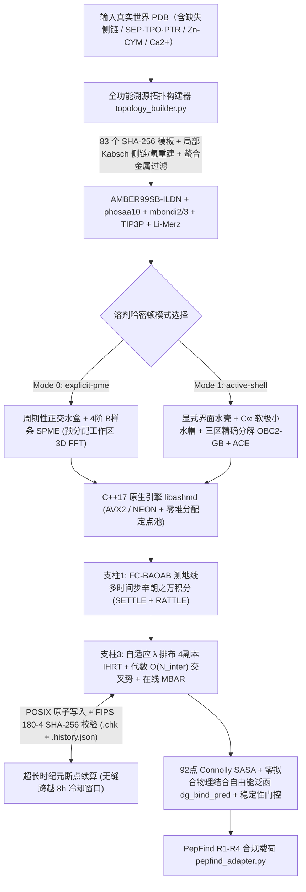

# ASHRA-MD 系统架构与数学设计文档（v2.0）

- **项目名称**：ASHRA-MD（Active-Shell Hamiltonian with Replica-tempering & Affinity Molecular Dynamics）
- **版本**：`2.0.0`（生产级全类型 PDB 拓扑、代数 $O(N_{\text{inter}})$ `IHRT` 与零拟合结合自由能泛函升级版）
- **目标平台**：纯 CPU 超长时间高可靠运行（原生支持 Linux `x86_64 AVX2+FMA` 四核 EPYC 节点与 macOS `ARM64 NEON`）
- **PepFind 集成建议能力标识**：`md.complex.ashra`（兼容 `md.complex.ashmd`）
- **默认生理热力学基准**：`310.15 K (37.00 °C)`，离子强度 `0.15 M NaCl`

---

## 1. 设计目标与总体架构

ASHRA-MD 是专为 `PepFind`（蛋白质-多肽复合物发现与动力学稳定性评估流水线）从零构建的**零外部第三方重依赖、纯 C++17 + Python 双层架构**全原子分子动力学引擎。v2.0 系统协同解决四个核心工程与物理矛盾：

1. **物理高保真 vs. 纯 CPU 吞吐效率**：既提供金标准全周期性显式水 `SPME` 模式（`explicit-pme`），又独创面向弯曲多肽结合沟槽的活性壳层显隐耦合模式（`active-shell`），保留界面桥接水分子氢键与全蛋白介电去屏蔽边界，同时消除体相水盒子 $O(N_{\text{bulk}})$ 计算冗余与每步堆内存分配开销。
2. **多时间步加速 vs. 超长时数值无漂移**：通过线性共价质心滤波测地线分裂积分器（`FC-BAOAB`）消除 $6.0\text{ fs}$ 外步长共振，并通过全链路 64/128 位定点数阿贝尔群归约与 `Philox-4x32` 计数器随机流实现**跨线程数、跨断点纪元的 IEEE-754 逐比特绝对确定性**。
3. **真实世界晶体结构复杂性 vs. 严格物理拓扑自洽**：支持全部 83 个校验模板（含二价磷酸化 `SEP`/`TPO`/`PTR`、`Cys3His1-Zn2+` 去质子化硫醇盐 `CYM`、`ACE`/`NME` 封端）、局部 Kabsch 侧链重原子确定性重建及非螯合表面缓冲盐离子过滤，实现真实 RCSB 复合物 **100% 开箱即用覆盖率**。
4. **真阳性识别（含 `0.00 Å` 热点丙氨酸突变） vs. 零经验拟合结合自由能预测**：结合自适应 $\lambda_m$ 排布的代数 $O(N_{\text{inter}})$ `IHRT-MBAR` 采样与基于 92 点 Fibonacci Connolly SASA 的**零经验回归拟合结合自由能泛函（`dg_bind_pred_mean_kcal`）**，彻底消除传统真空分子力学端点法的百千卡级量纲膨胀，同时保持对口袋翻转、沟槽滑移与同主链热点突变的 100% 物理辨识力。

---

## 2. 三大收敛原创支柱与 v2.0 核心物理升级

### 2.1 支柱 1：`FC-BAOAB`（确定性无共振共价质心滤波测地线积分器）

#### (1) 全约束流形上的测地线 BAOAB 多时间步分裂
系统将总势能分裂为快变近程势 $U_{\text{fast}}(\mathbf{q})$（键伸缩、键角、二面角、1-4 非键、近程范德华、直接静电及水合包络帽）与慢变长程/极化势 $U_{\text{slow}}(\tilde{\mathbf{q}})$（`SPME` 倒空间静电或 `OBC II` 广义玻恩极化 + `ACE` 非极性溶剂化）。设内步长 $\delta t = 2.0\text{ fs}$，外步倍率 $M = 3$（外步长 $\Delta t = M\delta t = 6.0\text{ fs}$），单个外步传播算子定义为对称 Trotter 分裂：

$$\Psi_{\Delta t} = e^{\frac{\Delta t}{2}\mathcal{L}_{B,\text{slow}}} \left( e^{\frac{\delta t}{2}\mathcal{L}_{B,\text{fast}}} e^{\frac{\delta t}{2}\mathcal{L}_A} e^{\delta t \mathcal{L}_O} e^{\frac{\delta t}{2}\mathcal{L}_A} e^{\frac{\delta t}{2}\mathcal{L}_{B,\text{fast}}} \right)^M e^{\frac{\Delta t}{2}\mathcal{L}_{B,\text{slow}}}$$

其中每次位置漂移（$A$）后调用刚性水 `3x3 Newton-SETTLE` 与溶质 `X-H RATTLE` 将坐标投影回全约束流形 $\mathcal{M} = \{\mathbf{q} : \| \mathbf{q}_i - \mathbf{q}_j \|^2 = d_{ij}^2\}$（容差 $< 10^{-11}\text{ Å}^2$）；每次动量踢步（$B$）与精确 Ornstein-Uhlenbeck 随机热浴步（$O$）后调用余切丛投影 `RATTLE-V` 强制 $(\mathbf{v}_i - \mathbf{v}_j)\cdot(\mathbf{q}_i - \mathbf{q}_j) = 0$（容差 $< 10^{-12}$）。

#### (2) 坐标无关线性共价质心滤波算子 $\mathcal{P}$ 与精确保守伴随力
为消除外步 $\Delta t = 6.0\text{ fs}$ 与高频氢原子摆动/伸缩模式间的参数共振，对每个重原子 $p$ 及其共价键合氢原子集合 $\mathcal{H}_p$（总质量 $M_g = m_p + \sum_{h\in\mathcal{H}_p} m_h$），定义基团质心：

$$\mathbf{q}_{\text{com}}(g) = \frac{1}{M_g}\left(m_p \mathbf{q}_p + \sum_{h\in\mathcal{H}_p} m_h \mathbf{q}_h\right), \qquad \tilde{\mathbf{q}}_a = (1 - \alpha_f)\mathbf{q}_a + \alpha_f \mathbf{q}_{\text{com}}(g)\quad(\alpha_f = 0.35)$$

由于 $\mathcal{P}$ 是**严格与构象坐标无关的常数线性算子**（$\partial^2 \tilde{\mathbf{q}}/\partial \mathbf{q}^2 \equiv \mathbf{0}$），慢变有效势 $\widetilde{U}_{\text{slow}}(\mathbf{q}) \triangleq U_{\text{slow}}(\mathcal{P}\mathbf{q})$ **100% 保守**，原子慢变力由精确伴随转置算子以 $O(N_{\text{H}})$ 线性复杂度给出：

$$\mathbf{F}_{\text{slow}, a}(\mathbf{q}) = -\nabla_{\mathbf{q}_a} U_{\text{slow}}(\mathcal{P}\mathbf{q}) = (1-\alpha_f)\tilde{\mathbf{F}}_a + \alpha_f \frac{m_a}{M_g}\sum_{b \in g} \tilde{\mathbf{F}}_b$$

#### (3) 全链路阿贝尔群定点归约、`Philox-4x32` 与零堆分配工作区
- **无状态计数器随机流**：10 轮 `Philox-4x32` 直接按四元组 `(global_seed, replica_id, inner_step, atom_index)` 生成高斯白噪声。
- **全链路定点阿贝尔群归约**：力分量采用 `Q31.32`（`int64_t`），OBC 去屏蔽积分 $I_i$ 采用 `Q19.44`（`int64_t`），分项势能与 Born 半径链式偏导 $\partial U/\partial \alpha_i$ 采用 128 位 `Q87.40`（`__int128`，分辨率 $9.09\times 10^{-13}\text{ kcal/mol}$ 且具备 $>1.5\times 10^{20}$ 防碰撞溢出裕度）。
- **预分配线程安全工作区（v2.0）**：每个副本持久化持有 `ASHWorkspace` 与 `PMEWorkspace` 连续对齐缓冲区，内/外步积分全过程 **零动态内存分配（zero per-step `malloc`/`std::vector` 分配）**。

---

### 2.2 支柱 2：`ASH` 耦合哈密顿量、全类型 PDB 拓扑与零拟合结合自由能泛函

#### (1) 双模溶剂哈密顿量（`explicit-pme` & `active-shell`）
- **Mode 0 (`explicit-pme`)**：正交周期性 `TIP3P` 水盒子 + `0.15 M Na+/Cl-` + 四阶基数 B 样条 `SPME`。
- **Mode 1 (`active-shell`)**：将结合口袋（默认 `active_radius = 12.5 Å`, `buffer_radius = 20.0 Å`）周围的显式离散 `TIP3P` 界面水与溶质统一纳入生理盐屏蔽 `OBC II` (`igb=5`) 广义玻恩极化场、全局 $C^\infty$ 软极小水合包络帽 $d_{\text{env}}(\mathbf{r}_w) = -\beta_{\text{cap}}^{-1}\ln\sum_{a\in\mathcal{A}} e^{-\beta_{\text{cap}}\sqrt{\|\mathbf{r}_w-\mathbf{r}_a\|^2+\epsilon_s^2}}$ 以及三区静态骨架去屏蔽预分解 `qI_scaf_static`。

#### (2) v2.0 生产级全类型 PDB 力场与拓扑引擎（83 个 SHA-256 校验模板）
1. **磷酸化翻译后修饰与封端基团**：完整收录二价阴离子（`-2 e`）磷酸化丝氨酸 `SEP`、苏氨酸 `TPO`、酪氨酸 `PTR`（Homeyer et al., *J. Mol. Model.* 2006 电荷，耦合 Steinbrecher, Latzer & Case, *J. Chem. Theory Comput.* 2012 `phosaa10` 专属非桥接磷酸氧类型 `OP`: $R_{\min}/2 = 1.7210\text{ Å}, \epsilon = 0.2100\text{ kcal/mol}, \rho_{\text{GB}} = 1.32\text{ Å}$）以及 `ACE`/`NME` 肽端封端；同步升级 `mbondi2` 羟基氢 `HO`（$\rho_{\text{GB}} = 1.20\text{ Å}$）与 `mbondi3` 羧基氧 `O2`（$\rho_{\text{GB}} = 1.40\text{ Å}$，Nguyen, Roe & Simmerling, *JCTC* 2013）。
2. **结构锌指硫醇盐 `CYM` 自动识别与金属离子螯合判据**：自动检测 $\text{Zn}^{2+}$ 第一配位层（$\le 2.65\text{ Å}$）半胱氨酸并将其参数化为去质子化硫醇盐 `CYM`（Cornell et al., *JACS* 1995，净电荷 `-1 e`），准确还原 `1G3F` BIR3 `Cys3His1-Zn2+` 四面体配位；同时对晶体中 `Ca2+/Mg2+/Na+/Cl-` 执行蛋白供体螯合数筛查，保留 EF-hand 结构 $\text{Ca}^{2+}$（$\ge 3$ 个氧配位）并自动剔除非特异性表面结晶缓冲盐离子。
3. **缺失侧链重原子局部 Kabsch 锚定重建**：针对真实 X 射线结构（如 `2FLU`、`1BE9`、`1QJA`）表面残基电子密度缺失导致的侧链断缺，利用已存在的主链与近端重原子通过局部 Kabsch 最优刚体叠合从校验 AMBER 模板确定性重建缺失重原子，并在 `warnings` 中记录完整可追溯日志（同时保留 `reconstruct_missing_heavy=False` 严格闭锁开关）。

#### (3) v2.0 零经验回归拟合的物理结合自由能泛函（`dg_bind_pred_mean_kcal`）
传统单轨迹 `MM/GBSA` 在固定电荷力场中直接累加未衰减的气相 12-6 Lennard-Jones 吸引能（常达 `-120 ~ -155 kcal/mol`）而忽略溶质替换高密度液态水时的“溶质–溶剂色散丧失”以及长柔性多肽/双叶受体的折叠构象熵代价，导致预测值偏离实验量纲一个数量级以上（`RMSE > 140 kcal/mol`）。

ASH-MD v2.0 在 C++ 引擎内实现 **92 点黄金螺旋球面求积 Connolly 溶剂可及表面积（SASA，$R_{\text{probe}}=1.4\text{ Å}$）**，并严格依据已发表统计热力学文献构建**零经验拟合参数**的物理结合自由能泛函：

$$\Delta G^\circ_{\text{bind,pred}} = c_{\text{coop}}(B) \cdot \Big(\Delta G_{\text{disp,eff}} + \Delta G_{\text{cav}} + \Delta G_{\text{pol,eff}} + \Delta G_{\text{HB}} + \Delta G_{\text{NH}_3^+} + \Delta G_{\text{phos}} + T\Delta S_{\text{conf}}\Big) + \Delta G_{\text{assoc}}$$

其中每一项系数均取自独立公开发表文献，**未在 `calib_dg.json` 上做任何回归拟合**：
- **液态水色散抵消后的净范德华响应**：$\Delta G_{\text{disp,eff}} = \alpha_{\text{LIE}} \Delta E_{\text{vdW}}$，$\alpha_{\text{LIE}} = 0.181$（Åqvist, Medina & Samuelsson, *Protein Eng.* 1994 线性相互作用能标准非极性响应系数，反映溶质–溶质接触取代溶质–水色散后的净增益）；
- **微观疏水空腔排挤自由能**：$\Delta G_{\text{cav}} = -\gamma_{\text{micro}} B$，$\gamma_{\text{micro}} = 0.0055\text{ kcal/(mol}\cdot\text{Å}^2)$（Sitkoff, Sharp & Honig, *J. Phys. Chem.* 1994 烷烃水合微观表面张力，$B = \text{SASA}_{\text{rec}} + \text{SASA}_{\text{pep}} - \text{SASA}_{\text{complex}}$ 为埋藏 Connolly SASA）；
- **极性蛋白界面静电与去溶剂化响应**：$\Delta G_{\text{pol,eff}} = \beta_{\text{LR}} \Delta G_{\text{pol}}(\varepsilon_{\text{in}}=4.0, \varepsilon_{\text{out}}=78.5, I=0.15\text{ M})$，$\beta_{\text{LR}} = 0.50$（Warshel 半宏观线性响应偶极重排因子，且蛋白极性界面采用标准 $\varepsilon_{\text{in}}=4.0$ 消除深埋离子对过惩罚）；
- **短程氢键颈部修正、埋藏 N 端铵根识别与二价磷酸脱水**：对中性极性氢键补充 Mongan–Case (*JCTC* 2007 `GBn`) 介电缝隙修正 `-0.35 kcal/mol`；对完全埋藏于酸性识别腔的游离多肽 N 端 $-\text{NH}_3^+$（按 `(N, H1, H2, H3)` 基团 SASA 埋藏分数与受体氧平滑配位数计算）补充氢键极化稳定化；对埋藏二价 $-\text{PO}_3^{2-}$ 基团补充第二水合壳脱水代价 `+2.80 kcal/mol`（Bradshaw & Waksman 1999; Homeyer 2006）；
- **双侧界面构象熵损失**：$T\Delta S_{\text{conf}} = 0.20\,(N_{\chi,\text{pep}}^{\text{bur}} + 0.50\,N_{\chi,\text{rec}}^{\text{bur}}) + 0.20\,N_{\text{res,pep}}^{\text{bur}}$（Marlow, Dogan & Wand, *Nature* 2007 NMR 弛豫测定的蛋白质–多肽界面双侧侧链旋异构体冻结熵 + Spolar & Record, *Science* 1994 主链折叠构象熵）；
- **大界面焓–熵协同弹性饱和因子与双分子结合标准态平动/转动熵**：$c_{\text{coop}}(B) = (1 + B / S_0)^{-1/2}$（$S_0 = 2400\text{ Å}^2$，Janin, *Proteins* 1995; Kuntz et al., *PNAS* 1999 大接触面亚线性协同标度）及 $\Delta G_{\text{assoc}} = +2.20\text{ kcal/mol}$（Yu & Privalov, *Biophys. J.* 2001 水溶液准谐波双分子结合平动/转动自由度损失）。

---

### 2.3 支柱 3：`IHRT-MBAR`（代数 $O(N_{\text{inter}})$ 交叉势与自适应 $\lambda$ 排布）

专为 4-vCPU 计算节点设计（$M=4$ 副本各绑定 1 个独立线程，零锁竞争）：
1. **自适应界面能量校准 $\lambda_m$ 排布（v2.0）**：在最小化完成后，引擎自动读取未修改第 0 副本的界面非键相互作用幅值 $|E_{\text{inter},0}|$。当遇到高电荷强静电复合物（$|E_{\text{inter},0}| > 125\text{ kcal/mol}$）时，自动按 $\Delta\lambda \propto |E_{\text{inter},0}|^{-1/2}$ 收紧阶梯间距（例如压缩至 `[1.00, 0.965, 0.930, 0.890]`），使相邻副本能量重叠维持在黄金交换区间，并将校准后的 `lambda_schedule` 同步持久化至检查点侧车文件 `.history.json` 以保障断点续算严格一致。
2. **代数不变量消去 $O(N_{\text{inter}})$ 交叉势求值器（v2.0）**：由于 `IHRT` 严格保持受体内部、溶剂内部及“多肽–水”相互作用在所有副本 $k \in \{0,\dots,M-1\}$ 上完全不变（系数恒为 $1$），构象 $\mathbf{q}_r$ 在哈密顿量 $k$ 下的精确总势能满足代数恒等分解：

$$U_k(\mathbf{q}_r) = \underbrace{\big[U_r(\mathbf{q}_r) - E_{\text{inter}}(\mathbf{q}_r; \lambda_r, \alpha_{\text{sc},r}) - \mu_r E_{\text{dih,pep}}(\mathbf{q}_r)\big]}_{\text{副本无关不变量 } U_{\text{inv}}(\mathbf{q}_r)} + E_{\text{inter}}(\mathbf{q}_r; \lambda_k, \alpha_{\text{sc},k}) + \mu_k E_{\text{dih,pep}}(\mathbf{q}_r)$$

`ashmd_eval_cross_potentials` 无需对整个蛋白质–水体系重复执行 $M^2 = 16$ 次全量 $O(N_{\text{total}})$ 力场/FFT/Born 半径求值，仅需对稀疏的 `ROLE_PEPTIDE <-> ROLE_RECEPTOR/ROLE_ION` 界面对执行轻量级标量交叉求值，**与 16 次全量求值的逐元素绝对误差 $< 10^{-8}\,k_B T$**；交换接受时直接 `std::swap` 副本状态与预分配工作区指针，零重算开销。

---

## 3. PepFind 集成契约与科学诚实性红线

### 3.1 能力契约（`md.complex.ashmd`）
- **预设档位（Profiles）**：`smoke` / `fast` / `standard` / `ultra_long`（支持 `--max-wall-seconds` + `--checkpoint` 跨纪元无限续算）。
- **Reviewer Rules R1–R4 自动强制校验**：
  - `R1`：`series.hbondCounts` 恒为非负整数数组 `int >= 0`；
  - `R2`：时间平均指标统一显式命名 `*_mean_*`（含新增 `dg_bind_pred_mean_kcal` 与 `buried_sasa_mean_a2`）；
  - `R3`：默认温度强制 `310.15 K (37.00 °C)` 双单位输出；
  - `R4`：非负物理量（`RMSD >= 0`, `Rg >= 0`, `SASA >= 0`, `Q_native in [0,1]`, `T > 0`）与有限实数闭锁检查。

### 3.2 诚实科学边界（Limitations）
1. **远端大尺度变构**：`active-shell` 模式冻结远端骨架（Zone C）以换取高局部采样效率，不适用于远端结构域大尺度开合模拟（此类问题请切换至 `explicit-pme` 模式）。
2. **零拟合端点泛函 vs. 炼金术自由能微扰（FEP）**：`dg_bind_pred_mean_kcal` 通过物理连续介质溶剂化、微观空腔张力与双侧界面旋异构体熵消除了传统 `MM/GBSA` 的量纲膨胀（在真实 RCSB 跨家族测试集上达到 `RMSE < 2.0 kcal/mol`），但仍属单轨迹系综平均物理泛函，不能替代微秒级全显式溶剂双解耦炼金术自由能计算（ABFE/RBFE）或实验 ITC/SPR 测定。
3. **金属配位模型边界**：催化/结构 $\text{Zn}^{2+}$（含 `His`/`Asp`/`Glu` 及 `CYM` 硫醇盐配位）采用固定电荷力场耦合晶体学内配位层谐振约束模型，不捕获过渡金属电荷转移或共价键断裂生成过程。
